# RIMessage [开发中]

当前进度: `R2.8开发中-基本的群组聊天功能`

为了方便您对整个项目的流程架构的有一个大体理解，我使用了 **DeepSeek** 生成了以下图表来辅助理解

---

## 1. 总览架构

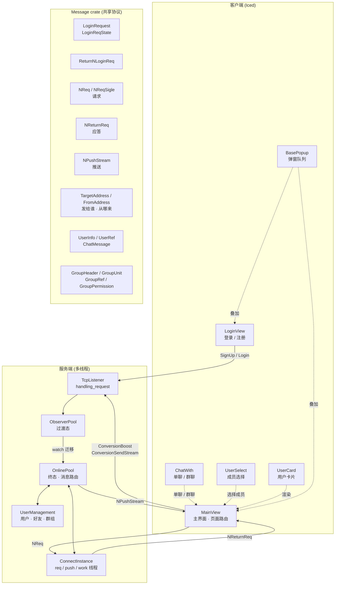

**解释**：客户端和服务端通过 `Message` crate 里定义的协议通信。

客户端按页面拆分：`LoginView` 负责注册与登录，`MainView` 负责登录后的页面路由与业务请求，`ChatWith` 负责单聊和群聊两个页面，`UserSelect` 是建群时的成员选择弹窗。

服务端从 `TcpListener` 接连接，交给 `handling_request` 处理握手；握手完成后连接进入 `ObserverPool`，配对成功再由 `watch()` 迁移到 `OnlinePool`，由 `ConnectInstance` 的三个工作线程负责日常读写。

**群组数据与好友数据一起保存在 `UserManagement` 里**（`group: Vec<GroupHeader>`），群消息由 `OnlinePool` 负责按成员分发——这部分在 [第 11 节](#11-群组消息分发-fan-out) 展开。

---

## 2. 协议定义

协议分成三条轨道，外加两个「地址」类型。

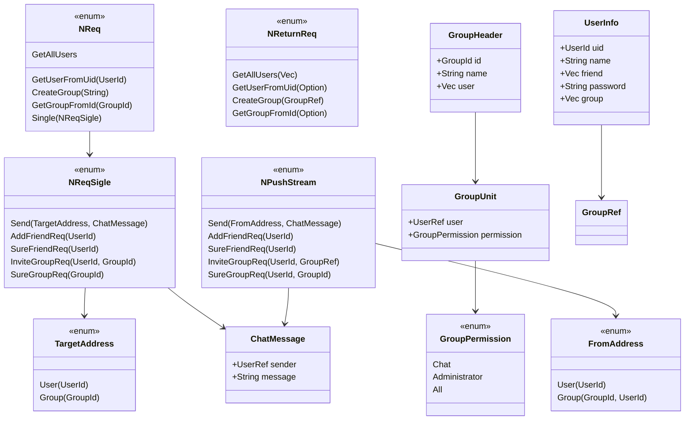

**解释**：三条轨道各管一件事。

- **登录轨道**：`LoginRequest` + `ReturnNLoginReq`。注册、登录、升级请求流、注册推送流，全部走这条，用完即结束。
- **业务轨道**：`NReq` + `NReturnReq`。连接身份确立后的日常请求，一问一答。`NReq::Single(NReqSigle)` 是大多数操作（发消息、加好友、建群、邀请）的统一入口。
- **推送轨道**：`NPushStream`。**只有服务端能发**，客户端被动接收。好友申请、群邀请、聊天消息都从这里下来。

两个地址类型是群组功能加进来的关键：

| 类型              | 用在哪           | 回答的问题                                            |
| ----------------- | ---------------- | ----------------------------------------------------- |
| `TargetAddress` | 客户端 → 服务端 | 这条消息**发给谁**（某个人 / 某个群）           |
| `FromAddress`   | 服务端 → 客户端 | 这条消息**从哪来**（某人私聊 / 某个群里的某人） |

`FromAddress::Group(group_id, sender_uid)` 一次带两个信息：**哪个群** + **谁说的**。客户端据此把消息放进对应的会话记录里——私聊按 uid 归档，群聊按群 id 归档。

群权限用枚举而不是两个布尔字段，是为了让「是群主但不是管理员」这种状态**在类型层面就不存在**。

---

## 3. 注册 → 登录 → 双连接握手（完整时序）

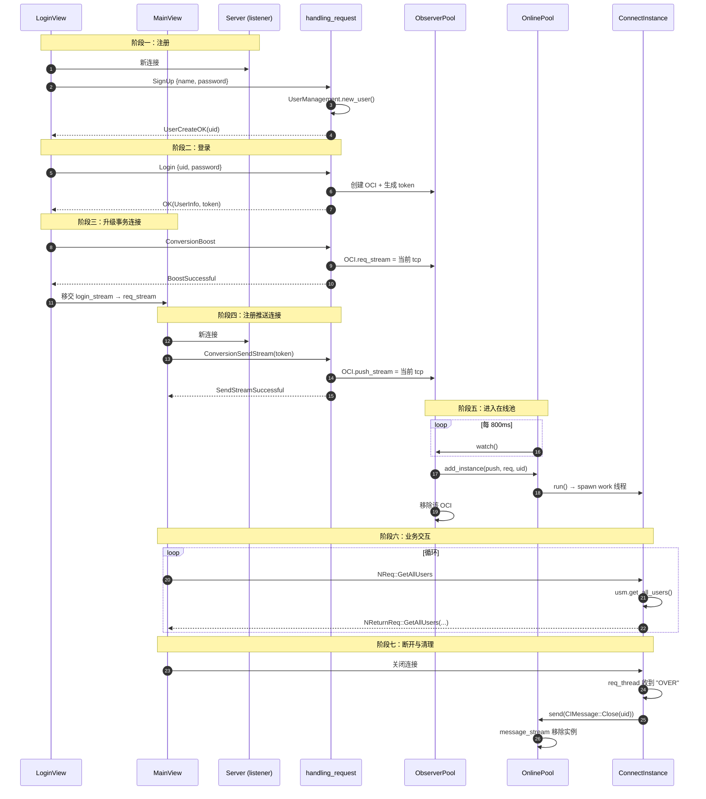

**解释**：整个握手分七个阶段。

前四个阶段是**客户端主动发起**的：注册 → 登录 → 升级事务流 → 注册推送流。每一次都是请求-响应模式，客户端发一条，服务端回一条。

第五阶段是**服务端内部**的：后台线程 `watch()` 每 800ms 扫一遍观察池，发现某人的两条流都到位了，就把它迁移到在线池，并启动工作线程。

第六阶段是**业务阶段**：客户端在事务连接上发业务请求，`ConnectInstance` 的 `req_thread` 收到后处理并返回。

第七阶段是**清理**：客户端断开后，`req_thread` 检测到 `"OVER"`，通过事件通道上报给 `OnlinePool`，`message_stream` 把实例从池子里移除。

---

## 4. 观察池：连接配对的状态机

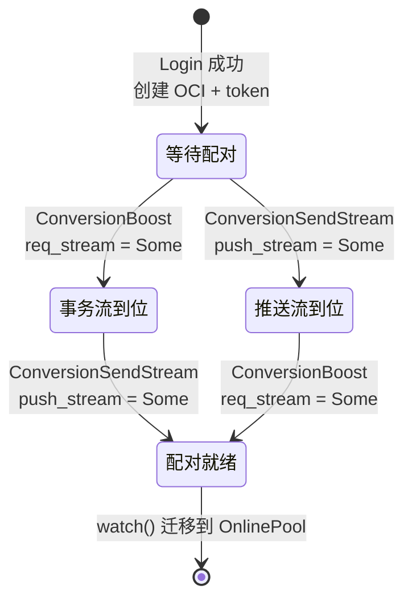

**解释**：`ObserveConnectionInstance` 有三个状态。

- **等待配对**：刚创建，两条流都是 `None`。
- **事务流到位 / 推送流到位**：收到其中一条连接，但另一条还没到。
- **配对就绪**：两条流都是 `Some`，`observe()` 返回 `true`，下一轮 `watch()` 会把它迁移到 `OnlinePool`。

状态机的重点是：**两条流到达的顺序无关紧要**。先事务后推送、先推送后事务都可以，最终都能到达“配对就绪”。

---

## 5. 池迁移流程

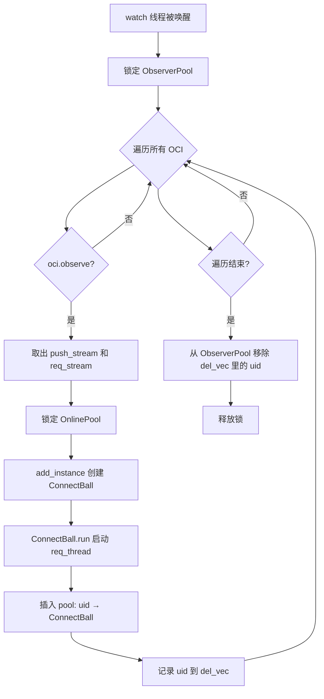

**解释**：`watch()` 的核心逻辑是“先收集、再删除”。

遍历阶段：对每个 `OCI` 检查 `observe()`。如果就绪，`take` 出两条流，交给 `OnlinePool::add_instance`，同时把 uid 记进 `del_vec`。

清理阶段：遍历结束后，统一从 `observer_pool` 里删除 `del_vec` 里的所有 uid。

这种“两段式”写法避开了“边遍历边删除”的借用冲突，也避免了锁的嵌套问题。`add_instance` 里的锁只在“创建 ConnectBall + 插入 pool”这段短暂持有，`run()` 启动线程后立即返回，不会阻塞后续用户的迁移。

---

## 6. 在线池的线程模型

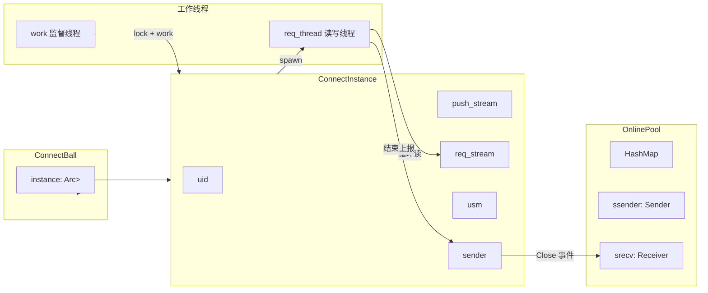

**解释**：这个图里有三个“层”的线程。

- **`work` 监督线程**：`ConnectBall::run` 里 spawn 的。它拿一下 `ConnectInstance` 的锁，spawn 出 `req_thread`，然后立即返回释放锁。它本身几乎不做事，是一个“启动器”。
- **`req_thread` 读写线程**：真正干活的线程。循环读 `req_stream`，解析 `NReq`，处理，写回 `NReturnReq`。客户端断开时循环退出。
- **`message_stream` 清理线程**：独立循环，通过 `try_recv` 检查 `srecv`，一收到 `Close(uid)` 就把该 uid 从 `pool` 里删除。

`sender` 是 `ConnectInstance` 持有的通道发送端。它在 `req_thread` 结束后发送 `Close(uid)`，触发清理。

---

## 7. `req_thread` 的内部循环

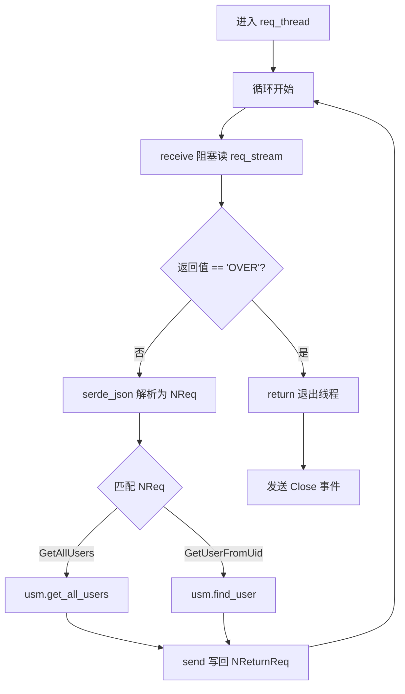

**解释**：`req_thread` 是一个同步的请求-响应循环。每次 `receive` 会阻塞等待一条消息，读到后解析、处理、写回，然后继续读下一条。

关键点是 `"OVER"` 这个哨兵值。`receive()` 在客户端断开时返回 `"OVER"`，此时线程直接 `return`，不解析、不处理。返回后，外层闭包会发送 `Close(uid)` 事件，通知 `OnlinePool` 清理。

`"OVER"` 用字符串是因为它不可能和任何合法 JSON 冲突——所有合法 `NReq` 都至少是 `"GetAllUsers"` 或 `{"GetUserFromUid": ...}` 这样的形式。

---

## 8. 断开清理时序

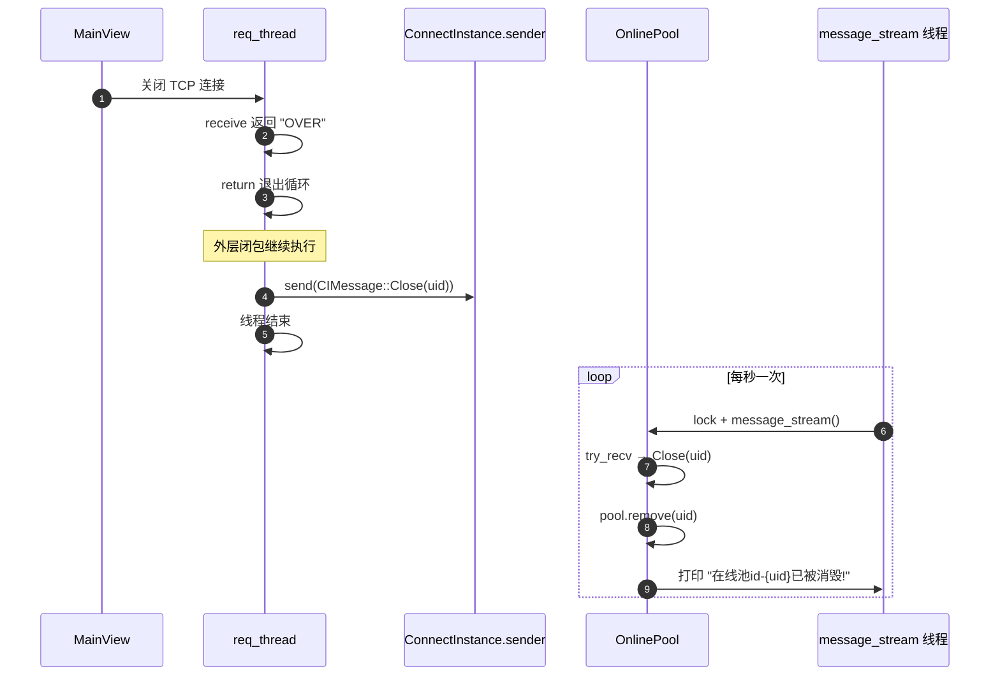

**解释**：断开清理分两段。

第一段在 `req_thread` 内部：读到 `"OVER"` 后 `return`。外层闭包不 join，直接往 `sender` 发 `Close(uid)`。

第二段在 `message_stream` 线程里：独立循环，每秒 `try_recv` 一次。收到 `Close(uid)` 就从 `pool` 里移除。移除后该用户的 `ConnectBall` 被 drop，其内部的 `Arc<Mutex<ConnectInstance>>` 引用计数归零，`ConnectInstance` 被释放，两个 `TcpStream` 自动关闭。

这样设计的好处是：**断开的检测和资源的释放是解耦的**。`req_thread` 只负责上报“我结束了”，`OnlinePool` 负责“删除注册”。即使 `req_thread` 和 `message_stream` 跑在不同的时间线上，也不会遗漏。

---

## 9. 客户端 UI 消息路由

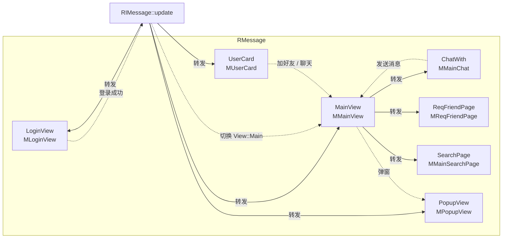

**解释**：客户端用**嵌套消息**做组件间通信。

`RMessage` 是顶层枚举，每个变体装着一个子组件的消息枚举。`RIMessage::update` 本身不做业务，只做转发——`MainView` 再把消息二次转发给 `ChatWith`、`ReqFriendPage` 等子页面。

**群聊页面 `ChatWith` 有两套状态**：`talk_user` 管单聊，`talk_group` 管群聊。输入框、发送按钮、滚动区都各有一套。

**唯一的例外是 `talk_group`**：它是 `Arc<Mutex<GroupHeader>>`，同时被 UI 线程和推送线程持有。

- UI 线程：每次渲染前读一次（拿群名、成员列表、聊天记录的 key）
- 推送线程：收到 `SureGroupReq` 后，**如果当前打开的就是这个群**，直接覆盖它

这样就避免了「成员列表是打开群那一刻的快照」——有人入群时，界面会自动刷新，不需要重新点开群。

---

## 10. 完整系统数据流（含群组）

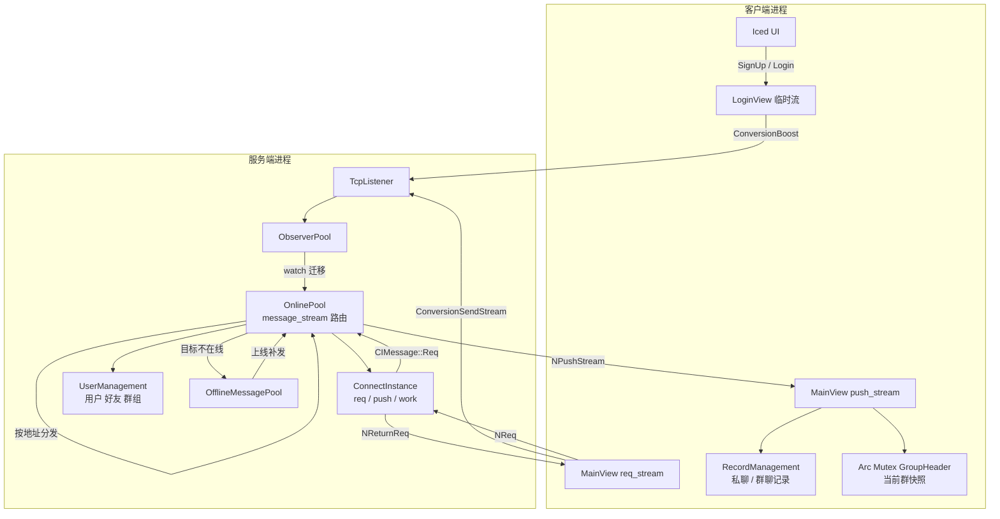

**解释**：这是整张系统的全景图，和早期版本相比有三处变化。

**一、推送流已经通了。** 早期 `push_stream` 只是「待命」的入口，现在服务端的 `OnlinePool` 会主动往里面写：好友申请、群邀请、聊天消息全部走这条路。

**二、消息路由收敛到 `OnlinePool::message_stream()`。** 客户端的请求先经过 `req_thread`，转成内部消息 `CIMessage::Req` 送进通道；`message_stream` 从通道取出来，按 `TargetAddress` 决定推给谁：

- `User(u)`：推给单个人
- `Group(g)`：查群成员列表，推给每一个人

**三、离线池对所有消息生效。** 不管私聊还是群聊，只要目标用户不在线，消息就落进 `OfflineMessagePool`，等他下次登录时补发。

**客户端侧**：收到的推送按 `FromAddress` 分拣——私聊进 `RecordManagement.tap`（按 uid 归档），群聊进 `RecordManagement.group`（按群 id 归档）；如果收到的群消息正好是当前打开的群，还会顺带更新 `talk_group`。

---

## 11. 群组消息分发（fan-out）

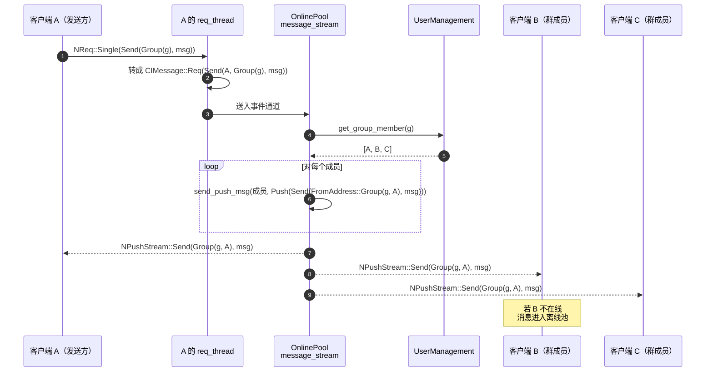

**解释**：群消息比私聊多一步「查成员」，其余完全复用同一条投递链路。

**发送方自己也会收到一条回显。** 这是刻意的设计：客户端在发送时**不往本地记录里预插**，一律等服务端推回来再显示。好处是「本地状态」只有一个来源，不会出现「本地加了一条、服务端又推一条」的重复；代价是发送到显示之间多了一次往返（本机测试里约十几毫秒）。

**入群流程**是另一条链路：

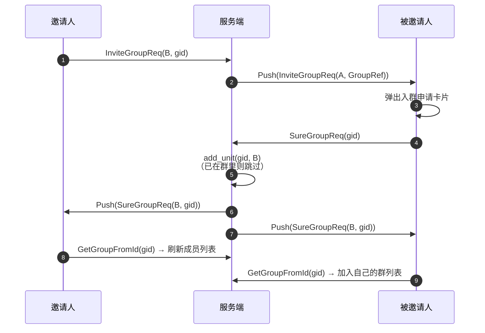

**`add_unit` 与 `add_group` 都做了去重**（按 uid / 按群 id），所以重复点击「同意」不会产生两个成员。

**还没做的部分**：退群、解散群、群内权限校验（目前任何成员都能邀请别人）、群消息自动滚动。
